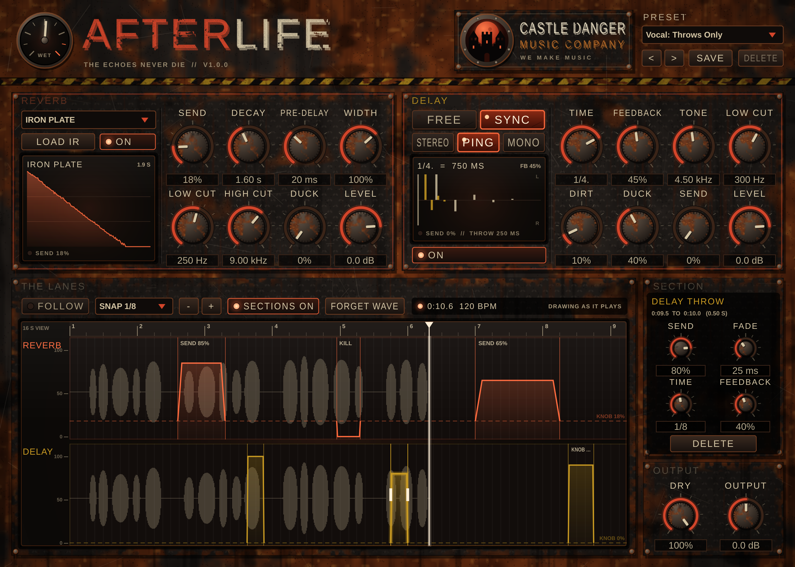

# Afterlife

A convolution reverb and delay (VST3 / AU) by **Castle Danger Music Company**. *The Echoes Never Die.*



Afterlife puts a convolution reverb and a tempo-synced delay on one insert, with **two lanes** underneath them: a REVERB lane and a DELAY lane. Each lane shows your track's waveform and follows the DAW's playhead. To change what happens on one part of the song, drag over it to mark a **section**. For example, you can put more reverb on one word, kill the reverb on another, or throw a dotted-eighth echo onto the end of a line.

- **Reverb:** 8 built-in spaces (Chamber, Crypt, Catacomb, Cathedral, Cistern, Iron Plate, Mausoleum, The Void), or load your own IR (WAV / AIFF / FLAC, up to 16 s). Controls: Send, Decay, Pre-Delay, Width, Low Cut, High Cut, Duck, Level
- **Delay:** Sync (1/64 to 1/1, dotted and triplet) or free (ms). Controls: Feedback, Stereo / Ping-Pong / Mono, Tone, Low Cut, Dirt (tape saturation, wow and flutter), Duck, Send, Level
- **The lanes:** sections set how much goes *into* each effect, so tails always ring out naturally. A delay section can also set its own **time and feedback** (a *throw*). The throw's echoes keep those settings while they fade, even after the section ends.
- **Waveform:** used as an insert, Afterlife draws the waveform as the song plays and saves it with the song. Applied to a clip with **ARA** (e.g. Fender Studio Pro), it draws the whole clip at once without playing it first.
- **Follow:** the lanes scroll with the playhead. Scroll or drag the ruler to look around, and Ctrl / Cmd + scroll to zoom. Edges snap to the song's grid (beat, 1/8, 1/16 or off).
- Zero latency. Factory presets and user presets. Presets only change the knobs: your sections belong to the song.

See `controls.txt` for every control and `readme.txt` for installing.

## Building

Pushing to `main` runs GitHub Actions. It builds macOS (VST3 + AU, universal, with ARA) and Windows (VST3, with ARA), then:

- uploads the builds as workflow artifacts, and
- pushes the release zips to the `downloads-macos` / `downloads-windows` branches.

Two Linux jobs also run:

- **Headless checks** (`test/snapshot.cpp`): dry passes untouched, every space's tail decays, delay timing (sync, dotted, free), feedback and ping-pong. They also cover the lanes (a KILL section, a section that adds reverb to one word and rings out, a delay throw with its own time and feedback that keeps ringing, sections off, transport stopped, no overlaps), waveform capture, save / reload of sections + waveform + loaded IR, all presets, LOADED IR and user presets. The editor is rendered to PNGs and uploaded as the `gui-snapshots` artifact.
- **ARA host** (`test/ara_host.cpp`): builds the real VST3 with ARA and applies it to a clip. It checks that the whole clip is read without playing, that it plays back on time and untouched, and that the reverb tail rings past the end of the clip.

Local build:

```
cmake -B build -DCMAKE_BUILD_TYPE=Release
cmake --build build --config Release --target Afterlife_VST3
```

Add `-DAFTERLIFE_ARA_SDK=/path/to/ARA_SDK` (Celemony ARA SDK, releases/2.3.0) for ARA.

Built with JUCE 8.0.15 (same as Flatliner, Cutthroat, Torment, Possessed and Dead Air). All built-in impulse responses are generated by Afterlife itself; no third-party IR recordings are bundled.
